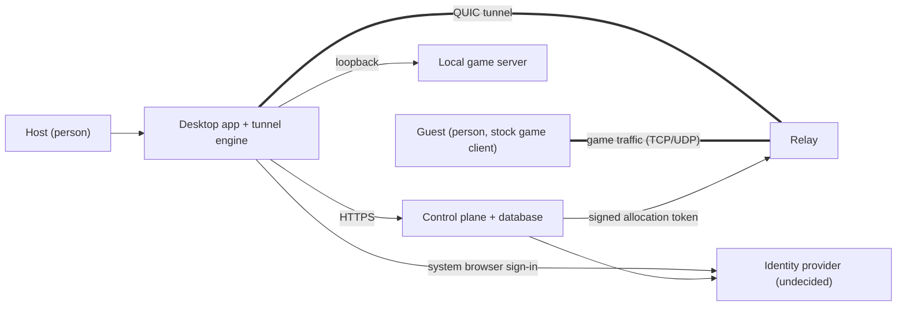
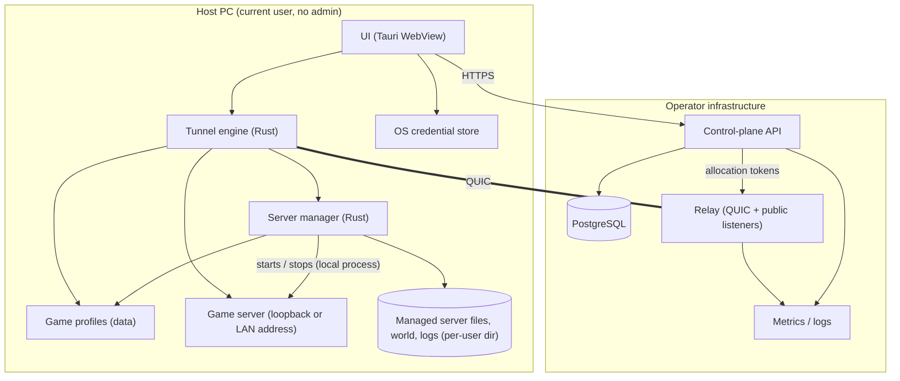
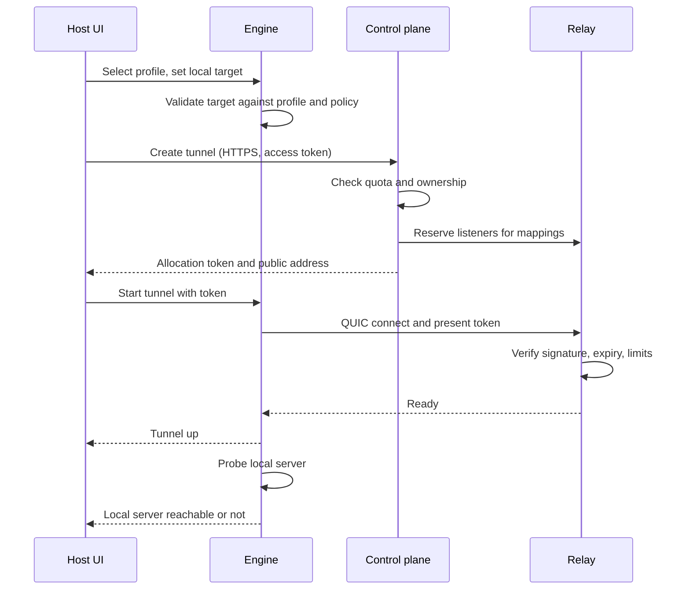
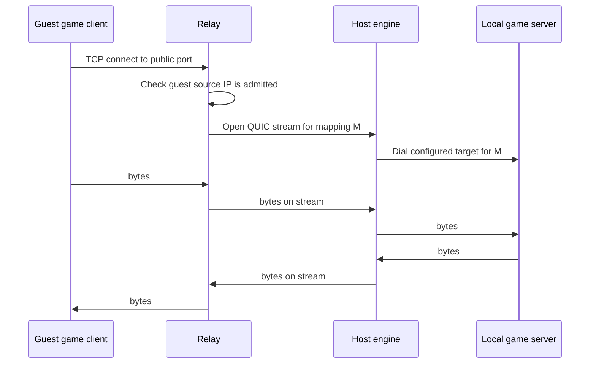

# architecture.md — System Architecture

**Status:** DRAFT v0.1.1. Canonical for system architecture and component responsibilities.
**Last updated:** 2026-10-17 (host-local game server provisioning added; see §5, §11, §12, §18)

**Read this first.** Everything here is a *proposal* built on `research.md`, where most game and transport facts are still "reported" or "needs experiment". Items tagged **[Depends on ADR-007]** assume guests use the stock game client against a relay-allocated address. Mermaid diagrams were parsed successfully with the Mermaid 10.9.8 parser (syntax only; visual rendering and layout were not checked). Message formats and schemas live in `contracts.md` and `data-model.md`; this document does not define them.

## 1. System goals and constraints

Goals: connectivity without port forwarding; TCP and UDP; honest status; security by design; controllable cost; modular game profiles (`context.md` §5).

Constraints:
- Windows-first, per-user install, no administrator rights in normal use.
- Relay-first. Direct P2P is deferred (ADR-002, experiment E-7).
- Relay never connects to destinations chosen by clients (ADR-003).
- No client telemetry by default (ADR-010).

## 2. Recommended technology stack

| Layer | Choice | Status | Why / main risk |
|---|---|---|---|
| Desktop shell | Tauri 2 (system WebView2 UI) | Proposed, ADR-005, low–medium | One language with the engine. Risk: UI/accessibility behavior unmeasured (E-8). Fallback: WPF + Rust sidecar |
| Tunnel engine | Rust library, in the app process | Proposed | Quinn exposes QUIC datagrams. Risk: unproven under game traffic (E-6) |
| Transport | QUIC: streams for TCP, DATAGRAM frames for UDP | Proposed, ADR-001, low–medium | UDP over a reliable stream adds latency (research RQ-3) |
| Relay | Rust service sharing the protocol crate | Proposed | Same code as engine |
| Control plane | Rust HTTP API, `axum` | **Accepted 2026-10-17, ADR-008, medium confidence** | Shares the protocol crate with the engine and relay, so token and message types cannot drift. Maintenance and licensing verified; `axum` 0.8.9 MIT. Revisit as a new ADR if team fit changes |
| Database | PostgreSQL (durable state only), driver `sqlx` | **Accepted 2026-10-17, ADR-008, medium** | `sqlx` 0.9.0 Apache-2.0, pushed 2026-10-16, not archived. Costs: 145 transitive crates and MSRV 1.94 (workspace must rise from 1.77). Relay session state stays in memory |
| Auth | System-browser OAuth (PKCE), OS credential store | Proposed, ADR-009 | Identity provider undecided |
| Observability | `tracing` + optional OTLP | Proposed, ADR-010 | OTel Rust traces are beta |
| Packaging | Per-user NSIS + signed updater | Proposed, ADR-006 | Update/rollback untested (E-9) |

## 3. High-level architecture and responsibilities

Four runtime parts plus a game-specific data layer:

1. **Desktop app** (UI + engine): configuration, game profiles, local reachability checks, the tunnel client, and (since 2026-10-17) the **server manager**.
2. **Control plane**: identity, authorization, tunnel and invitation lifecycle, relay allocation, quotas, admin and abuse operations.
3. **Relay**: terminates the host's tunnel connection, owns public listeners for allocated mappings, forwards traffic.
4. **Game profiles**: declarative data describing each game's ports, protocols, and validation rules.

**Control plane versus data plane.** The control plane carries small, infrequent, authenticated HTTPS requests (create tunnel, issue token, revoke). The data plane carries game traffic over QUIC between engine and relay and over public sockets between players and relay. The relay trusts only signed allocation tokens from the control plane; it never calls back to decide per-packet policy.

### 3.1 System context

### 3.2 Containers and components

**Server manager boundary (added 2026-10-17).** The server manager runs entirely inside the desktop app's process tree. It never talks to the relay or the control plane, and it never receives a destination from them. It is not part of the control plane or data plane. The only inputs it accepts are the host's own choices (which profile, which local port, which options); the only outputs are the local process and the status pushed to the UI.

## 4. Repository and directory structure

Proposed Cargo workspace plus a UI package (not created yet):

| Path | Responsibility |
|---|---|
| `apps/desktop/` | Tauri shell and UI; no networking logic |
| `crates/engine/` | Tunnel client: QUIC connection, stream and datagram handling, local dialing, health checks |
| `crates/protocol/` | Message types, state machines, token parsing shared by engine, relay, control plane |
| `crates/relay/` | Relay service: allocation validation, public listeners, flow tables, limits |
| `crates/control-plane/` | HTTP API, authorization policy, persistence |
| `crates/profiles/` | Loader and validator for game profile files |
| `crates/server-manager/` | **Added 2026-10-17.** Artifact acquisition and verification, generated configuration, process supervision, world backup. Runs only on the host's PC; no networking to the relay or control plane |
| `profiles/` | One declarative file per game (data, not code) |
| `migrations/` | Authoritative schema migrations (see `schema.md`, planned) |
| `infra/` | Deployment definitions per environment |
| `scripts/` | **Added 2026-10-17.** Repository tooling: `audit_traceability.py` (TEST-008 — requirement/task/identifier consistency, prerequisite cycles, cited-path existence, longest-chain depth, ADR table/record agreement, and `data-model.md` vs `schema-draft.sql` column agreement; self-testing against 10 planted defects) and `check_contrast.py` (UX-005 — recomputes the `DESIGN.md` §3 contrast table from the §2 tokens; self-validating). Both run in CI. API-route agreement and diagram agreement remain uncovered — T-120. |
| `tests/{integration,game-compat,network,security,perf}/` | Test suites by type |
| `docs/` | **Inconsistency, recorded 2026-10-17:** this row calls `docs/` "the documentation set", but the 20 documents actually live at the repository root alongside the code. Only `docs/dependency-register.md` is under `docs/`. **Not moved** — moving 20 files would break every relative link across the set and is not required by T-001. Decide at T-004 and do it as one change that fixes all links together. |

Rule: networking behavior lives in `crates/*`, never in the UI package.

## 5. Component specifications

| Component | Responsibilities | Inputs | Outputs | Depends on | Failure behavior | Security assumptions |
|---|---|---|---|---|---|---|
| UI | Onboarding, profile selection, status display, invitations | User actions, engine events | Commands to engine and API | Engine, API, credential store | Shows error and retry; never hides engine failure | Runs unprivileged; never receives raw secrets after storage |
| Engine | Hold tunnel, dial configured local targets, report health | Allocation token, mappings, profile | Status events, forwarded bytes | Relay, profile data | Reconnect with backoff; close local sockets on stop | Only dials targets in the host's own mapping list |
| Control plane | AuthN/Z, lifecycle, relay allocation, quotas | HTTPS requests | Tokens, records, audit events | DB, IdP, relay registry | Fail closed on auth errors; stop issuing tokens if DB down | Trusted to sign tokens; keys held in secret store |
| Relay | Verify token, open public listeners, forward, enforce limits | QUIC from engine, public TCP/UDP | Forwarded traffic, metrics | Control-plane signing keys (public verification only) | Drops traffic when token expires or limits hit; drains on shutdown | Sees game traffic in the default guest model; treats all public input as untrusted |
| Profiles | Declare ports/protocols/validation per game | Files | Typed profile objects | none | Invalid profile rejected at load | Data only, no executable content |
| Server manager | Download and verify the official artifact, generate configuration, supervise the process, back up the world | Profile (provisionable only), host's local choices | Local process, status events, log excerpts | Profiles, per-user data directory | Refuse to run an unverified artifact; bounded crash restart; surface the log and stop after repeated failures | Writes only under the user's profile; never reads a destination from the network; never elevates; RCON and query off by default |

Server manager notes:

- **Where files live.** Artifacts, world, generated configuration, and logs live under a per-user directory (`%LOCALAPPDATA%\<app>\servers\<profile>` or equivalent — exact path set during implementation). Nothing is written outside it and no service or startup entry is created (`SRV-010`).
- **Verification before execution.** An artifact is checked against the integrity method recorded by experiments E-15/E-16 before it is unpacked or run. If no integrity method exists for a game, that game is not provisionable (`SRV-002`, `SRV-003`).
- **No network-derived input.** The local address and port come from the engine's own configuration, in process. There is no code path by which a relay message, an API response, or a profile fetched at runtime could change them (`SRV-005`, INV-1, SEC-006).
- **Generated configuration defaults.** RCON and query off **where the game has them** — Java edition only; Bedrock has neither (`research.md` RQ-13.3), so no such toggle is offered there. World-list and LAN-visibility settings set to the least exposure the game allows; note Bedrock's `enable-lan-visibility` defaults to **true** and binds the default ports even when the configured ports differ, so a provisioned Bedrock server sets it false. `online-mode` stays **true**. IPv6 listener behavior recorded from E-16. The host must accept the game's own terms, which the app cannot and must not accept on their behalf (`SRV-004`).
- **Credential conflict (open).** A generated RCON secret has to be readable by the server from its configuration **file**, which appears to contradict SEC-002. Recorded as ADR-014 and left open for gate G1; not resolved here.

## 6. Control-plane and data-plane communication

- Engine to control plane: HTTPS with a short-lived access token (`contracts.md` will define routes).
- Control plane to relay: signed, expiring allocation token delivered to the engine, which presents it on the QUIC handshake. The relay verifies the signature offline. [A] This avoids a per-connection callback and keeps the relay stateless with respect to accounts.
- Relay health and load: relay reports to the control plane out of band so allocation can avoid unhealthy relays.

## 7. Authentication and authorization (summary)

- Hosts sign in through the **system browser** with OAuth authorization code + PKCE per RFC 8252 (research RQ-9); refresh tokens live in the OS credential store.
- Authorization rules (to be fully specified in `contracts.md`): only the tunnel owner may start, stop, or view it; invitations are scoped to one tunnel, expiring, and revocable; admin operations require separate admin credentials.
- **Guest access [Depends on ADR-007].** A stock game client cannot present a token. Proposed mechanism: the guest opens the invitation link, which registers the guest's current public IP for that tunnel for a limited time; the relay admits only registered source IPs to the tunnel's public listeners. The invitation link opens a small web page (guest claim page, `user-flows.md` G1) served on the control-plane side; it performs the claim and shows the address and a per-game instruction. This page is part of the initial release scope (T-084). Known weakness: shared and changing addresses (CGNAT, mobile) and friends behind the same NAT. Experiment E-13 decides whether this works. Game-level passwords and whitelists remain the second line of defense.

## 8. Critical flows

### 8.1 Create and start a tunnel

### 8.2 Guest data path

TCP:

UDP: the relay keeps a flow table keyed by guest source address and mapping. Each datagram is prefixed with a mapping index and a flow id (6-byte header, `contracts.md` §11) and sent as a QUIC DATAGRAM. The engine keeps one local UDP socket per flow so replies return to the right guest, and idle flows are expired (timeouts to be tuned in E-6).

The engine resolves the mapping id **only** against the host's local mapping list. A mapping id the host never configured is dropped. This is the mechanism behind ADR-003.

## 9. TCP and UDP handling

| Aspect | TCP | UDP |
|---|---|---|
| Carrier | One QUIC stream per guest connection | QUIC DATAGRAM frames tagged by mapping index and flow id |
| Reliability | Provided by stream | None added; losses are the game's concern |
| Backpressure | Stream flow control; relay pauses reading the public socket | Drop with a counter when the datagram queue is full |
| Size limit | None | Must fit one QUIC packet; oversize packets are dropped and counted. Real limits unmeasured (E-6) |
| Cleanup | Close both ends on either side's close; limit idle time | Flow expiry timer |

Per-profile, per-mapping protocol selection prevents, for example, exposing a Source server's RCON on TCP 27015 unless the host explicitly enables it (`research.md` RQ-1).

## 10. NAT traversal and relay fallback

Initial release is **relay-only**. Direct P2P upgrade is a later optimization pending E-7. The engine always connects outbound to the relay, so no inbound port on the host is needed. If UDP to the relay is blocked, the engine needs a fallback carrier for the tunnel itself (for example, QUIC over a different port, or a TCP-based fallback). That fallback is **not designed yet**; it is a required design task and a known gap for restrictive networks.

## 11. Game-specific integration

Each profile file declares: protocols and default ports per mapping, which mappings are optional and default-off (query, RCON), whether the game binds extra ports (`research.md` notes Bedrock's LAN-visibility binding), and the validation checks the engine runs locally. Support scope per game follows `research.md` §2 and ADR-011 levels L0–L2. A game is not shown as "supported" in the UI until its L2 test has passed.

## 12. Status model

The UI must show three separate facts, never one merged "connected":

1. **Tunnel**: Created, Allocating, Connecting, Active, Degraded, Reconnecting, Stopped, Failed.
2. **Local server reachable**: result of the engine's local probe (L0, and L1 where a probe exists).
3. **Players seen**: best-effort count from relay flow tables. This shows traffic, not confirmed in-game presence.

**Managed server (added 2026-10-17) — a fourth source, never a merge.** When the app provisions the game server itself, that process can be Not installed, Downloading, Verifying, Configuring, Starting, Running, Crashed, Updating, or Failed. This is reported as its **own** indicator (`SRV-006`); it does not replace indicator 2 and must not be presented as "local server reachable". Indicator 2 still means "a game server answered on the configured local address", which stays true or false independently of what the server manager is doing (`FR-010`, `UX-002`).

**Confirmed presence (added 2026-10-17, P2) — a fifth, opt-in source.** Indicator 3 above is *observed traffic* and must stay that way by default. A managed **Java** server can additionally be asked directly who joined, over the Server Management Protocol (`research.md` RQ-13.4). When that is enabled, presence the game server itself reports is shown as a **separate, differently-labelled** signal — "confirmed by the game server" — never merged into the traffic count (`SRV-011`). Bedrock offers no equivalent; stdin console control gives start, stop and `op` but no join events. No game may ever be shown as in-game on traffic evidence alone.

## 13. Configuration and secret management

- Client: settings file in the user's profile directory holds non-secret settings only; tokens in the OS credential store.
- Services: configuration through environment variables or a secret manager; signing keys never in the repository or logs. Variable names will be listed in `README.md` once defined (none exist yet).
- Key handling: control-plane signing key is rotated on a schedule; relays accept a set of current public keys to allow overlap. Rotation interval and revocation list design are open items.
- **Managed server files (added 2026-10-17).** Generated server configuration, world data, and logs live under the per-user server directory, not in the settings file. Logs are included in the diagnostics bundle only through the redaction pipeline (`FR-013`, PRIV-002). A generated game-server credential that the server must read from its own configuration file is an **open conflict with SEC-002**; ADR-014 must resolve it before any such credential is written.

## 14. Deployment topology

| Environment | Shape |
|---|---|
| Development | Engine, control plane, one relay, Postgres, and one game server container on a developer machine |
| Staging | Production-like control plane and one relay in a separate account; synthetic and game-compat tests |
| Production | Control plane and database in one region; one or more relays, region choice **undecided** (AS-6) |

Hosting provider is undecided; egress allowances and pricing differ and conflict between sources (`research.md` RQ-8).

## 15. Observability and health

Metrics (names illustrative): tunnels active, allocation failures, relay datagrams dropped (by reason), bytes in/out per allocation, handshake failures, reconnect counts, latency samples. Logs are structured and redacted: no tokens, no payload bytes, minimal player addresses with a short retention (values to be set in `requirements.md`). Health checks: relay liveness and capacity reported to the control plane; engine self-checks surfaced in the UI. Client telemetry is off by default.

## 16. Failure modes and recovery

All timeout and retry values below are **proposed starting points** to be tuned by experiments, not validated numbers.

| Failure | Detection | Recovery |
|---|---|---|
| Host loses internet | Heartbeat miss / QUIC idle timeout | Engine reconnects with exponential backoff and jitter; relay keeps the allocation for a grace period, then releases |
| Relay becomes unhealthy | Health report or connection errors | Control plane reallocates; engine reconnects to the new relay; guests may need the new address (address stability is an open design issue) |
| Allocation token expires mid-session | Relay closes connection | Engine refreshes token from control plane and reconnects |
| Local game server not listening | Engine probe fails or dial errors | UI reports "local server unreachable"; tunnel stays up |
| UDP blocked to relay | Handshake times out | Fallback carrier (not yet designed, see §10) |
| Control plane down | API errors | Existing tunnels continue while their token is valid; no new tunnels |
| Update fails | Updater verification or launch failure | Keep previous version; surface error (E-9) |

## 17. Scalability and cost

- Relay cost is dominated by egress, which tracks total game traffic (research RQ-8). No per-session byte measurement exists; capacity and quota numbers are deferred to E-10.
- Public listener ports are a finite resource per relay IP; a port pool and per-account tunnel limits are required. Pool size is not yet determined.
- Horizontal scale: add relays; the control plane assigns allocations. The control plane is expected to be low-volume compared to the data plane.

## 18. Threat model and security boundaries

Trust boundaries: host PC, local game server, control plane, relay, public internet (guests and scanners).

| Threat | Mitigation (proposed) | Verification |
|---|---|---|
| Relay used as an open proxy to arbitrary destinations | Relay never dials destinations; only forwards to the host's own engine (ADR-003) | Security test: attempt unknown mapping ids |
| Engine tricked into reaching other local or LAN services | Engine dials only host-configured targets; default loopback; profile validation | Destination validation tests |
| Public endpoint scanned or abused | Source-IP admission, per-IP and per-tunnel connection and bandwidth limits | Security and perf tests, E-13 |
| Stolen invitation | Expiry, single-tunnel scope, revocation, rate-limited claim | Token tests |
| Token replay / forgery | Short expiry, signature verification, audience binding | Token tests |
| Relay compromise | Default model lets the relay see game traffic: disclosed; limit retention; deferred end-to-end option | Review; ADR-004 |
| Malicious game server on the host attacking guests | Out of scope for the tunnel; guests are warned they connect to the host's server | Docs |
| Resource exhaustion at relay | Per-allocation limits, global limits, backpressure | Load tests |
| Update supply-chain attack | Signed artifacts, signature verification, "dangerously" updater options off | E-9 |
| Secrets in logs | Redaction rules, tests for secret leakage | Security tests |
| **Tampered or unofficial server artifact executed on the host** | Official channel only, integrity verification before execution, unverified games are not provisionable | Security test: corrupt an artifact in the test fixture |
| **Managed server exposes something by default** (RCON, query, world list, IPv6 listener) | Generated configuration with the least-exposure defaults; RCON off unless the host enables it | Security test + configuration review |
| **Managed server becomes an attack surface on the host PC** | No elevation, no service, per-user directory only, world and config not shared, update verified and reversible | Security review; E-18, E-19 |
| **Managed server crash loop consumes the host's resources** | Bounded restart with backoff; automatic restart stops after the limit and surfaces the log | Load/soak test; E-17 |
| **Managed server port or world data leaks to the operator** | Local address and port stay in process (SRV-005); server files are never uploaded; diagnostics pass through redaction | Request-capture test; leak test |
| **Game server opens its own path in, bypassing the tunnel** | Terraria's `serverconfig.txt` documents `upnp=1` and the server auto-forwards its port via uPNP on launch. Generated configuration sets `upnp=0`. **A host whose own manually-configured server has uPNP on has already exposed themselves**, so the app warns about it rather than assuming the tunnel is the only way in | Config-generation review; warning copy review |
| **Managed server exposes an internal-to-external UDP port mapping** | Bedrock's `server-udp-ports` supports `[ip:]external:internal` mappings, which could publish a port the host never configured. Must not be enabled in generated configuration | Security test: assert generated config omits it |
| **Managed server exposes a management surface** | Java `enable-jmx-monitoring` stays off (default); MSMP is off by default and localhost-bound when enabled; RCON never enabled (ADR-015); Source NET_CON_PORT never exposed | Configuration review |
| **Guests are indistinguishable to the game server, or a host locks themselves out** | Source games identify players by IP. If every guest appears as loopback, game-level IP banning stops working and the game's RCON brute-force ban can ban the host's own address (`research.md` §2.2). Unresolved — open issue 13. Until it is settled, the UI must not promise game-level IP banning | Engine data-path test; E-3/E-5 |

**Encryption statement.** Client-to-relay traffic is encrypted by QUIC/TLS. Guest-to-relay traffic is whatever the game itself uses, usually unencrypted. The relay therefore can read game traffic in the default guest model. This is not end-to-end encryption.

## 19. Trade-offs and deferred features

Deferred: direct P2P (E-7), guest client with end-to-end encryption (ADR-004/007), Windows service, other platforms, Steam lobby support unless E-4 passes, fallback carrier design (required before release), multi-relay failover with stable guest addresses.

## 20. Open design issues

1. Stable public address per tunnel across relay failover.
2. Source-IP admission viability (E-13).
3. Fallback carrier for networks that block UDP.
4. Public port allocation and, for Minecraft Java, whether hostname-based addressing is useful.
5. Identity provider choice.
6. Region and hosting provider selection.
7. **Added 2026-10-17:** how a generated game-server credential is handled when the server must read it from a configuration file (ADR-014, conflicts with SEC-002).
8. **Added 2026-10-17:** whether the control plane needs to know that a tunnel's game server is managed. Current decision is **no** — the managed server is host-local state and no schema change is made, which keeps INV-1 intact. Revisit only if support or UX needs it.
9. **Added 2026-10-17, from `research.md` RQ-13:** Bedrock's firewall prompt versus the no-elevation promise. BDS makes Windows Defender ask for a firewall rule on first start, and adding an inbound rule needs elevation. The tunnel needs no inbound port, so the intended behaviour is that the app creates no rule and the host declines — but this is unverified and could break provisioning.
10. **Added 2026-10-17:** Bedrock's loopback restriction versus the local probe. A Bedrock *client* on the same machine cannot reach BDS without a `CheckNetIsolation` exemption. If an ordinary process such as the engine is also affected, `FR-011`'s probe breaks for Bedrock.
11. **Added 2026-10-17:** Bedrock cannot reload settings, so every generated-configuration change needs a stop → write → start sequence. There is no live-apply path; the engine's state machine must not assume one.
12. **Added 2026-10-17:** whether to enable the Java Server Management Protocol by default on a managed server. It would give confirmed player presence and richer supervision, at the cost of opening a local authenticated API and requiring a TLS keystore (`research.md` RQ-13.4, ADR-015, `SRV-011`). Default-off is the safer starting position.
13. **Added 2026-10-17, HIGH PRIORITY — does the engine preserve per-guest source addresses?** Source-engine games (Left 4 Dead, Left 4 Dead 2) identify connected players **by IP**, and use that address for banning and for protecting RCON (`research.md` §2.2). Because the engine opens a *new* local socket to the game server for each guest, every guest currently appears to arrive from the same host-local address, which would collapse all guests into one identity and could make the game's own RCON brute-force ban lock the host out of its own server. **Partly resolved 2026-10-17 (`research.md` §2.2.1):** the proposed fix — binding a distinct loopback source address per guest flow — was tested and **works at the OS level** on Windows for TCP and UDP, at 64-way concurrency with zero collapsed identities, with no elevation required. A loopback source pool of ~16 million usable addresses is available, excluding `127.0.0.0` and `127.255.255.255`. **The scheme must be IPv4** — `::2` does not bind, so only `::1` is available on IPv6. **Still undecided, and still load-bearing:** whether a Source engine server actually honours the distinct address (needs a real server — E-3/E-4/E-5), and whether that makes the game's RCON brute-force ban safe. The OS result does not settle those.
14. **Added 2026-10-17 — no separation of duties exists, by decision (ADR-019).** The project owner is the sole administrator *and* the developer with database access. Adding a second factor does not create separation of duties, so admin authentication protects against a stolen or escalated **user** session and against accidental destructive action, and **not** against the administrator or against database compromise. Compensating controls are the append-only admin audit trail (detective) and step-up re-authentication (accidental damage only). Recorded as an **accepted risk**, not a mitigated one. Revisit if an operator team ever exists — the audit trail is what makes that review possible.
15. **Added 2026-10-17 — automated administration is not covered by ADR-019.** If anything administrative is ever done by a machine rather than by the owner (a controller draining relays on deploy, for example), that requires a workload identity or certificate, not a second factor. Undecided.

## 21. Links

`context.md`, `idea.md`, `research.md`, `data-model.md`, `schema.md`, `contracts.md`, `api.md`, `requirements.md`, `spec.md`, `tasks.md`, `plan.md`, `user-flows.md`, `ux.md`, `DESIGN.md`, `schema-draft.sql`, `review-report.md`, and `docs/dependency-register.md`.

At the repository root since T-001: `README.md`, `AGENTS.md`, `CLAUDE.md`, `CONTRIBUTING.md`.
