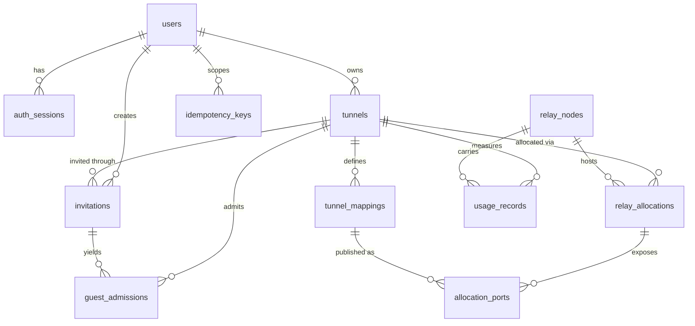

# data-model.md — Domain and Persistence Model

**Status:** DRAFT v0.1.1. Authoritative for the domain and persistence *design*. Physical DDL draft: `schema-draft.sql` (see `schema.md` for precedence).
**Last updated:** 2026-10-17

Retention durations and numeric bounds marked *(proposal)* are not validated; they must be fixed in `requirements.md` (privacy and quota requirements) before implementation. Nothing here has been run against a database; the DDL was syntax-checked with the PostgreSQL parser only.

## 1. Design principles

1. **Durable state only.** The database holds what must survive restarts or be audited. Connection and flow state lives in relay memory (§5).
2. **The control plane never stores local destinations.** A host's local target (address and port) exists only on the host's machine (ADR-003). No table has such a column; this is an invariant (INV-1).
3. **Secrets are stored as hashes.** Refresh tokens and invitation secrets are stored only as hashes. Signing keys are never in the database.
4. **Data minimization.** No email, no payload bytes, no raw guest IP in audit data. Guest source IPs are stored only in `guest_admissions` because the relay needs them.

## 2. Entities accepted, merged, or rejected

| Candidate | Decision | Reason |
|---|---|---|
| Users / identities | **Accept** `users` | Needed to own tunnels, enforce quotas, suspend abuse |
| Devices | **Reject (v1)** | `auth_sessions.device_label` is enough for session revocation; a device identity adds key management with no v1 requirement. Revisit if per-device certificates are chosen |
| Authentication sessions | **Accept** `auth_sessions` | Refresh-token rotation and revocation |
| Game profiles | **Reject as table** | Profiles are versioned files in the repository (`profiles/`), loaded by client and control plane. `tunnels` stores `game_profile_id` + `profile_version` |
| Tunnel sessions | **Accept** `tunnels` | |
| Tunnel endpoints and mappings | **Accept** `tunnel_mappings` | Protocol and mapping key per tunnel; no local target |
| Invitations and connection credentials | **Accept** `invitations`, `guest_admissions` | Invitation = revocable secret; admission = the source-IP grant the relay enforces (research E-13 may change this) |
| Relay nodes | **Accept** `relay_nodes` | Allocation and health |
| Relay allocations | **Accept** `relay_allocations`, `allocation_ports` | Allocation lifecycle; ports are a separate table because a failover changes the port |
| Usage records | **Accept** `usage_records` (aggregated) | Quotas and cost; no per-packet data |
| Audit events | **Accept** `audit_events` | Security and abuse review |
| Configuration settings | **Reject as table** | Environment/config files; feature flags can be added later |
| Idempotency keys | **Accept** `idempotency_keys` | Required by `contracts.md` idempotency semantics (small, TTL-bound) |

Admin identity: **decided 2026-10-17 (ADR-019)** — admin is a **separate identity, not a role on `users`**, and the project owner is the sole administrator. **Not modeled yet.** A separate admin identity store is a new entity and therefore a migration for T-033; it is deliberately *not* a `role` column on `users`, so that an admin session can never hold a tunnel and a user session can never carry admin capability. Recovery codes are hashed at rest and are the one declared, narrow exception to SEC-002. See `contracts.md` §9 for the authentication contract and `research.md` ADR-019 for the reasoning **and the accepted risk that separation of duties is absent**.

### 2.1 Managed game servers: deliberately not modeled (2026-10-17)

Host-local provisioning was added to scope (`context.md` G-7). **No table was added, and none is proposed.** Reasoning:

- The managed server is host-local state. Its artifact, world, configuration, and logs live in the host's per-user directory, not in the control plane's database.
- Its address and port are the same host-local target as any other mapping. Recording them would violate INV-1, the invariant this model exists to protect (`SRV-005`).
- The control plane has no role in provisioning: it never causes a server to be downloaded, started, or stopped, and it holds no credential for one.

Consequence: the operator cannot see, from the database, whether a tunnel's game server is managed, how old it is, or whether it is healthy. That is accepted for the first cut. If support or UX later needs it, the change must be made as an explicit decision in `architecture.md` §20 item 8, must carry no local target, and must be reviewed against PRIV-002 and PRIV-003.

## 3. Relationships



`audit_events` has deliberately no foreign keys.

## 4. Entity specifications

Types are PostgreSQL types. "Sensitive" means access-restricted and excluded from logs.

### users
- **Fields:** `id uuid PK default gen_random_uuid()`; `idp_issuer text NOT NULL`; `idp_subject text NOT NULL`; `display_name text NULL (1–64 chars)`; `status text NOT NULL default 'active' ('active'|'suspended')`; `created_at timestamptz NOT NULL default now()`; `deleted_at timestamptz NULL`.
- **Unique:** (`idp_issuer`, `idp_subject`). **Indexes:** the unique index.
- **Lifecycle:** created at first sign-in; `suspended` by an operator; deletion sets `deleted_at`, then a job stops the user's tunnels and removes the row (cascades to sessions, tunnels, invitations, idempotency keys).
- **Sensitive:** `idp_subject`. **Retention:** until deletion request, then removed. Deletion timing *(proposal, to be set)*.
- **Invariants:** a suspended user cannot create or start tunnels or refresh tokens; existing active tunnels are terminated on suspension.

### auth_sessions
- **Fields:** `id uuid PK`; `user_id uuid FK users ON DELETE CASCADE`; `family_id uuid NOT NULL`; `refresh_token_hash bytea NOT NULL UNIQUE`; `device_label text NULL (≤64)`; `created_at`; `last_used_at NULL`; `expires_at NOT NULL > created_at`; `revoked_at NULL`.
- **Indexes:** partial on `user_id WHERE revoked_at IS NULL`; `family_id`.
- **Lifecycle:** refresh rotates the token within a family; presenting an already-used token revokes the whole family (reuse detection).
- **Sensitive:** `refresh_token_hash`. **Retention:** delete rows a *(proposal)* grace period after expiry or revocation.

### tunnels
- **Fields:** `id uuid PK`; `owner_id FK users CASCADE`; `name text 1–64`; `game_profile_id text`; `profile_version int ≥1`; `state text default 'created' ('created'|'active'|'stopped'|'terminated'|'expired')`; `created_at`; `started_at NULL`; `stopped_at NULL`; `expires_at NOT NULL > created_at`; `termination_reason text NULL`.
- **Indexes:** (`owner_id`,`state`); partial on `expires_at WHERE state='active'`.
- **Lifecycle:** created → active (on start) → stopped (owner), terminated (operator/abuse), or expired (max lifetime). Terminal states are final; a new session is a new row.
- **Invariants:** `stopped_at` is non-null exactly when state is terminal (enforced by CHECK); at most one live allocation (INV-3); per-user active-tunnel quota is application-enforced (limit *proposal*, set in requirements).
- **Retention:** keep terminal rows for a *(proposal)* period for abuse review and usage reconciliation, then delete (cascades to mappings, allocations, usage).

### tunnel_mappings
- **Fields:** `id uuid PK`; `tunnel_id FK CASCADE`; `mapping_key text` (profile-defined, e.g. a game port or an optional query/RCON mapping); `protocol 'tcp'|'udp'`; `position smallint ≥0`; `enabled bool default true`; `created_at`.
- **Unique:** (`tunnel_id`,`mapping_key`); (`tunnel_id`,`position`); (`id`,`protocol`) (supports a composite FK).
- **Invariants:** `mapping_key` and `protocol` must match the tunnel's profile (INV-2, application-enforced); **no local address/port stored** (INV-1); `position` is the index used in UDP datagram headers (`contracts.md` §11).
- **Lifecycle/retention:** with the tunnel.

### relay_nodes
- **Fields:** `id uuid PK`; `name text UNIQUE`; `region text`; `public_host text`; `status ('provisioning'|'healthy'|'draining'|'unhealthy'|'retired')`; `max_allocations int >0`; `port_range_start`/`port_range_end` (1024–65535, start ≤ end); `created_at`; `last_health_at NULL`.
- **Lifecycle:** provisioning → healthy; draining stops new allocations; retired is final. Rows are operator-managed. **Retention:** indefinite (small).

### relay_allocations
- **Fields:** `id uuid PK`; `tunnel_id FK CASCADE`; `relay_id FK relay_nodes RESTRICT`; `state ('reserved'|'active'|'released'|'expired')`; `issued_at`; `expires_at > issued_at`; `released_at NULL`.
- **Unique/Indexes:** partial unique on `tunnel_id WHERE state IN ('reserved','active')` (INV-3); `(id, relay_id)` unique (supports composite FK); partial index on `relay_id` for live rows.
- **Lifecycle:** reserved on start → active when the engine connects → released on stop/failover, or expired if never used or past lifetime.
- **Retention:** same as tunnels.

### allocation_ports
- **Fields:** `allocation_id`, `mapping_id`, `relay_id`, `protocol`, `public_port int 1024–65535`, `released_at NULL`; PK (`allocation_id`,`mapping_id`).
- **Constraints:** composite FKs to `relay_allocations(id, relay_id)` and `tunnel_mappings(id, protocol)`; partial unique on (`relay_id`,`protocol`,`public_port`) `WHERE released_at IS NULL` (no two live mappings share a public port).
- **Invariant INV-4 (application-enforced, needs a test):** the mapping's tunnel must be the allocation's tunnel. The foreign keys do not enforce this.
- **Retention:** with the allocation.

### invitations
- **Fields:** `id uuid PK`; `tunnel_id FK CASCADE`; `created_by FK users CASCADE`; `token_hash bytea UNIQUE`; `max_claims int 1–50 *(bounds: proposal)*`; `claim_count int ≥0 ≤ max_claims`; `created_at`; `expires_at > created_at`; `revoked_at NULL`.
- **Unique:** (`id`,`tunnel_id`) (supports composite FK).
- **Lifecycle:** valid while not expired, not revoked, and `claim_count < max_claims`. The token secret is shown once at creation and never recoverable.
- **Sensitive:** `token_hash`. **Retention:** with the tunnel.

### guest_admissions
- **Fields:** `id uuid PK`; `invitation_id`, `tunnel_id` (composite FK to `invitations(id, tunnel_id)`); `source_ip inet NOT NULL`; `created_at`; `expires_at > created_at`; `revoked_at NULL`.
- **Indexes:** partial unique (`tunnel_id`,`source_ip`) `WHERE revoked_at IS NULL` (re-claim from the same IP refreshes instead of duplicating); index on `expires_at`.
- **Lifecycle:** created when a guest claims an invitation; expires or is revoked; the relay enforces the live set.
- **Sensitive:** `source_ip` (personal data). **Retention:** delete a short *(proposal)* time after expiry; never copied into logs or audit metadata.
- **Dependency:** the whole table exists only if experiment E-13 shows source-IP admission is workable (ADR-007).

### usage_records
- **Fields:** `tunnel_id FK CASCADE`, `relay_id FK RESTRICT`, `interval_start timestamptz`, `bytes_from_guests bigint ≥0`, `bytes_to_guests bigint ≥0`, `peak_flows int ≥0`, `datagrams_dropped bigint ≥0`; PK (`tunnel_id`,`relay_id`,`interval_start`).
- **Lifecycle:** upserted per interval from relay reports; interval length *(proposal)* set in config. **Retention:** *(proposal)* long enough for billing/quota reconciliation, then aggregated and deleted.

### audit_events
- **Fields:** `id bigint identity PK`; `occurred_at`; `actor_type ('user'|'admin'|'system'|'relay')`; `actor_id uuid NULL`; `action text`; `subject_type text`; `subject_id uuid NULL`; `request_id text NULL`; `metadata jsonb`.
- **Indexes:** `occurred_at`; (`subject_type`,`subject_id`).
- **Invariant INV-5:** `metadata` never contains tokens, payloads, or raw guest IPs; enforced by a code-level allow-list and a secret-leak test.
- **Retention:** *(proposal)* fixed period, then deletion. Append-only: no updates.

### idempotency_keys
- **Fields:** `user_id FK CASCADE`, `route text`, `idem_key text 8–128`, `request_hash bytea`, `response_status int NULL`, `response_body jsonb NULL`, `created_at`, `expires_at`; PK (`user_id`,`route`,`idem_key`).
- **Behavior:** same key + same hash → replay stored response; same key + different hash → conflict (`contracts.md` §8). **Retention:** expires after a *(proposal)* window.

## 5. Ephemeral and non-database state

| State | Where | Notes |
|---|---|---|
| QUIC connections, heartbeat timers | Relay and engine memory | Lost on restart; recovered by reconnect |
| UDP flow tables, TCP stream map | Relay and engine memory | Never persisted |
| Live admission set | Relay memory, rebuilt from the control plane | Revocation latency depends on poll interval (to be measured) |
| Allocation-token replay cache (`jti`) | Relay memory until token expiry | Tokens are short-lived by design |
| Rate-limit counters | Control plane / relay memory | Shared store only if multiple instances need it |
| Signing keys, relay credentials | Secret store | Never in the database |
| Engine settings, local targets | Host PC | Local targets are never uploaded |

## 6. Required invariants (summary)

| ID | Invariant | Enforced by |
|---|---|---|
| INV-1 | No local target address/port in any control-plane store or log | Schema review, test that scans schema and API payloads |
| INV-2 | Mapping key and protocol match the tunnel's profile version | Application validation, test |
| INV-3 | At most one live allocation per tunnel | Partial unique index |
| INV-4 | An allocation port's mapping belongs to the allocation's tunnel | Application, test (not enforced by FKs) |
| INV-5 | Audit metadata holds no secrets or raw guest IPs | Allow-list, leak test |
| INV-6 | A public (relay, protocol, port) is held by at most one live mapping | Partial unique index |
| INV-7 | Terminal tunnel states have `stopped_at` set | CHECK |

## 7. Typed models and runtime validation (Rust, illustrative)

Not compiled; the final crate choices are implementation decisions.

```rust
// crates/protocol (illustrative)
pub struct CreateTunnelRequest {
    pub name: String,                 // 1..=64 chars after trim, no control chars
    pub game_profile_id: String,      // must exist in the profile registry
    pub mappings: Vec<MappingRequest>,
}
pub struct MappingRequest {
    pub mapping_key: String,          // must be defined by the profile
    pub protocol: Protocol,           // Tcp | Udp, must match the profile
    pub enabled: bool,
}
```

Validation layering: (1) the wire-level contract, currently the definitions in `contracts.md` §15 and the message tables in `contracts.md` §§5 and 10 — **note 2026-10-17:** this originally cited a JSON Schema in `docs/contracts/`, which does not exist in this repository; T-031 must author the schemas, so until then `contracts.md` is authoritative; (2) typed deserialization rejects unknown fields; (3) a domain validation function checks profile rules (INV-2) and quotas; (4) database constraints are the last line of defense. A mismatch between layers is a test failure, not a runtime surprise.

## 8. Migration strategy and compatibility rules

- Forward-only SQL migrations, reviewed in pull requests, applied by a single migration step at deploy. Rollback means deploying a compensating forward migration, never editing history.
- **Expand/contract:** add nullable or defaulted columns first; deploy code that writes both; backfill; switch reads; drop old columns in a later release.
- Backwards-compatible: add table, add nullable/defaulted column, add index (built concurrently where supported). Not compatible without a multi-step plan: rename or drop a column, tighten a constraint, change a type.
- A migration that rewrites a large table needs an explicit plan and a staging rehearsal.
- Mapping `position` and the profile `profile_version` are compatibility-sensitive: changing them affects live tunnels.

## 9. Links

`architecture.md`, `contracts.md` (wire formats), `schema.md`, `schema-draft.sql`, `research.md`, `requirements.md` (retention, quotas).
