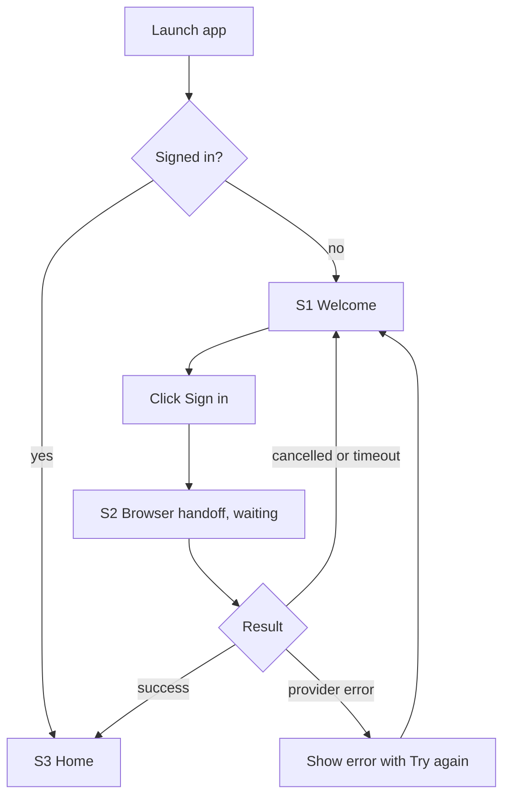
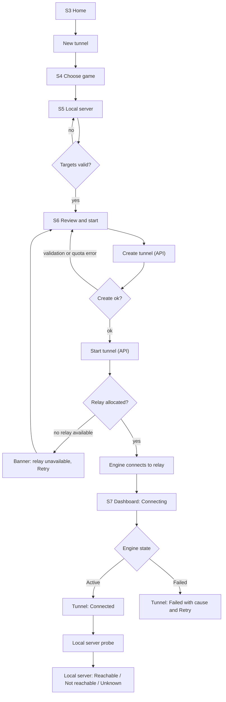
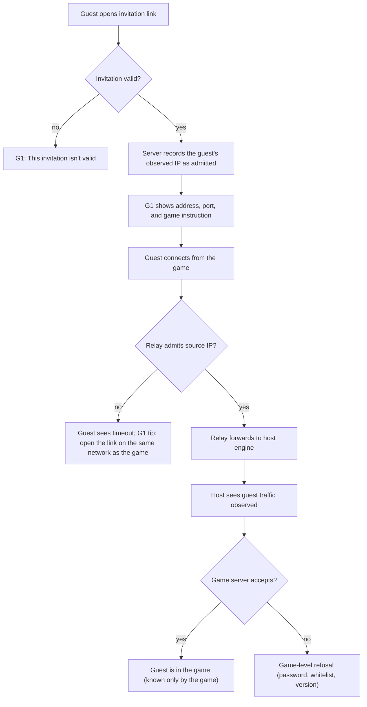
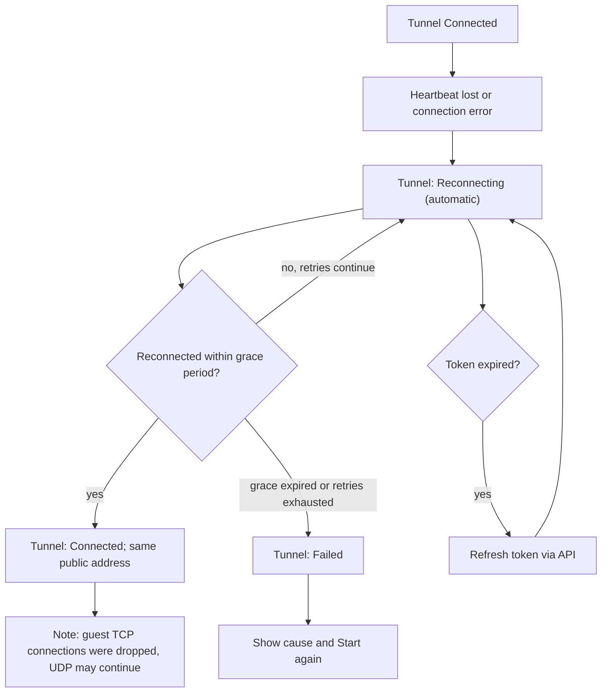
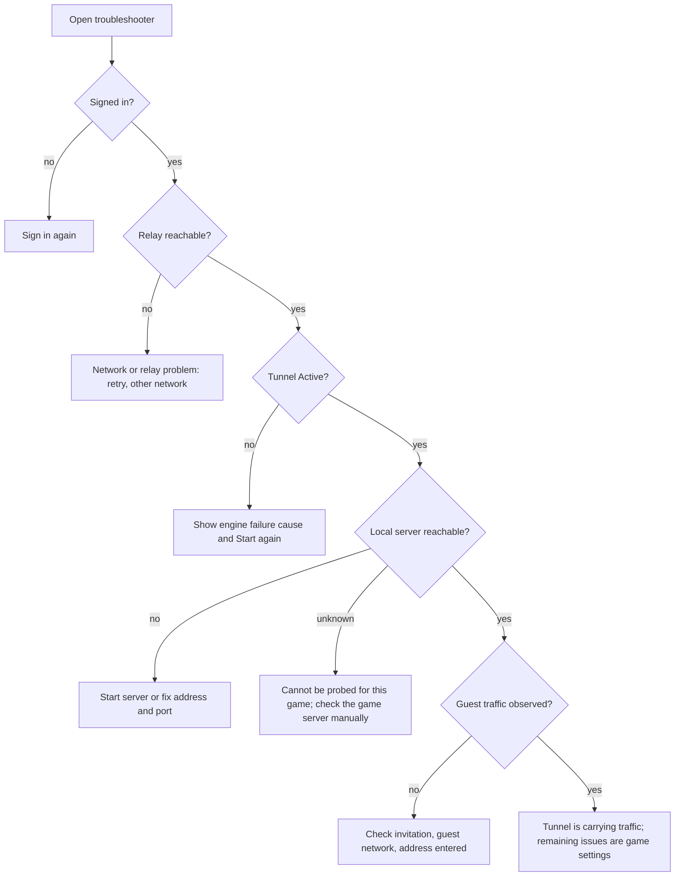
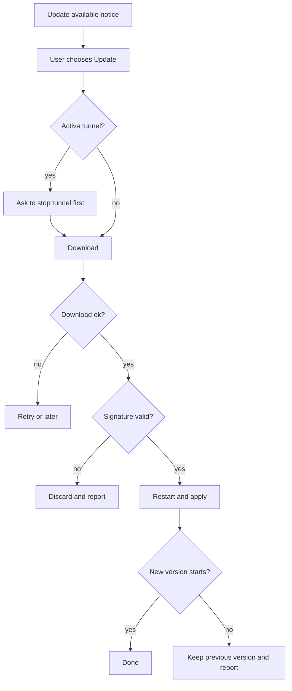

# user-flows.md — User Journeys

**Status:** DRAFT v0.1. Authoritative for interaction flows. Visual rules: `DESIGN.md`. Principles and navigation: `ux.md`. Behavior must agree with `architecture.md` and `contracts.md`.
**Last updated:** 2026-10-16

Mermaid diagrams in this file parse successfully with the Mermaid 10.9.8 parser (syntax only; visual rendering and layout were not checked, which remains part of task T-004). Flows that depend on guest source-IP admission carry **[E-13]**. Wording shown in quotes is draft copy, not final.

## 0. Three different kinds of "working"

The UI and every flow below keep these separate (FR-010, UX-002):

| Layer | Question it answers | Source | Can be true while the others are false? |
|---|---|---|---|
| **Tunnel** | Is my PC connected to the relay and is the public address live? | Engine state (`contracts.md` §12) | Yes: tunnel up, game server off |
| **Local server** | Is a game server answering on the configured local address? | Engine probe (L0, and L1 where a probe exists) | Yes: server up, tunnel down |
| **Players seen** | Has the relay observed guest traffic? | Relay `flow_summary` | Yes: traffic observed does not prove a player is in-game |

"A player has successfully joined the game" is **not** measurable by the app in general. The most it can say is "guest traffic observed". Only the game server knows who is in the game. Copy must never say "Connected to game" or "Players online" from tunnel status alone.

**Confirmed presence, opt-in (added 2026-10-17).** The rule above is unchanged by default. But a managed **Java** server can be asked directly, over the Server Management Protocol, which reports players joining and leaving (`research.md` RQ-13.4). When that is on and working, the dashboard may show a **separate, differently labelled** line such as "2 in game (reported by the server)" beside the existing "N guests seen" traffic count. The two must never be merged, the traffic count never gains an "in game" meaning, and if the protocol is unavailable the UI falls back to traffic only and says so. Bedrock has no equivalent (`SRV-011`, `UX-002`).

**Managed server (added 2026-10-17).** When the host asks the app to set the game server up, a fourth fact exists: what the server manager is doing (not installed, downloading, verifying, configuring, starting, running, crashed, updating, failed). It is shown as its **own** indicator and never replaces the *Local server* row above, which still means "a game server answered on the configured local address". Provisioning can be Downloading while Local server says Not reachable; both are correct at once (`SRV-006`, FR-010, UX-002).

## 1. Screens

| ID | Screen | Purpose |
|---|---|---|
| S1 | Welcome | First launch introduction |
| S2 | Sign-in handoff | Waiting while the system browser completes sign-in |
| S3 | Home | Tunnel list or empty state |
| S4 | Choose game | Select one of the profiles |
| S5 | Local server | Set local address and port per mapping; optional mappings off by default |
| S6 | Review and start | Summary of exposure, then Start |
| S7 | Tunnel dashboard | Three-part status, public address, invitations, details |
| S8 | Share dialog | Create and copy an invitation |
| S9 | Troubleshooter | Guided checks for a failed or non-working tunnel |
| S10 | Settings | Account, diagnostics export, updates, theme |
| S11 | Update dialog | Available, downloading, verifying, restart, failure |
| S12 | Managed server setup (added 2026-10-17) | Offer to set up the game server; download and verification progress; generated-configuration summary; world and version; backup, restore, update |
| G1 | Guest claim page (web) | Guest opens an invitation link and sees how to connect |

The guest page G1 is a small web page served by the control-plane side; it is listed in `architecture.md` §7.

## 2. Journey 1 — First launch and onboarding

**Screens:** S1 → S2 → S3. **Preconditions:** app freshly installed, no session. **Success:** user is signed in and sees the empty Home with one primary action. **Failure:** sign-in cancelled or fails; user stays on S1 with a retry. **Loading:** S2 shows a spinner and "Finish signing in in your browser", with Cancel. **Retry:** "Try again" restarts the browser handoff. Identity: `contracts.md` §5.1 (provider-dependent).

## 3. Journey 2 — Account creation or authentication

Accounts are created at first successful sign-in with the identity provider (provider **not yet chosen**, ADR-009). The app never shows or stores a password. **Failure outcomes:** suspended account shows "This account can't create tunnels. Contact support." (`forbidden`); network failure shows the connection banner with Retry. Sign-out is in S10 and revokes the session (FR-001).

## 4. Journey 3 — Initial application configuration

First run asks nothing technical. Settings defaults: theme follows the OS, no telemetry (PRIV-001), updates on. The only prompt is a one-time notice that explains that the operator's relay carries game traffic and can technically read it (SEC-011, PRIV-005), with a link to details. **Success:** notice acknowledged. **Failure:** none blocking; the notice remains reachable from S10.

## 5. Journeys 4–7 — Select a game, configure the server, create and start

**Journey 4 (select game, S4):** list of the five games, each with its support level and scope text (GAME-006). A game that has not passed its L2 test in this release shows "Experimental". **Journey 5 (local server, S5):** per mapping, local host and port with defaults from the profile (editable, GAME-009). Optional mappings (query, RCON) are off with a one-line risk explanation. Invalid values show inline messages (policy `contracts.md` §13). Nothing about local targets is sent to the server (FR-003). Detection is best-effort: "Check now" runs the local probe; manual entry always works.

**Journey 5b — Let the app set the server up (S5 → S12), added 2026-10-17 [E-15] [E-16].** Only offered for profiles on the provisionable list (`SRV-003`); for other games the option is absent and manual configuration is the only path, stated plainly rather than shown as a disabled button.

Steps and copy rules:

1. S5 shows **"Set this up for me"** beside manual entry, with one line on what will be downloaded and roughly how much space it needs *(size from E-18; not yet known, so no number is shown until then)*.
2. The host confirms the game's terms. **The app cannot accept them on their behalf**; it shows where they are and records the host's confirmation locally. Refusing returns to manual entry.
3. S12 shows progress as discrete steps — download, verify, configure, start — with a cancel option that is honest about what has already happened. Download and verification are named separately so the host can see that nothing is run before it is checked.
4. Before starting, the host sees what the generated configuration will expose: RCON off and query off **for Java edition only — Bedrock supports neither, so no such toggle is shown** (`research.md` RQ-13.3); Bedrock's LAN-visibility set off and `online-mode` left on; world-list settings; IPv6 listener. Enabling RCON is a separate, confirmed action.
5. On success S12 shows the managed server's own status indicator and the address it is listening on. The *Local server* indicator on the dashboard then reports reachable or not, from the ordinary probe — it does not get special treatment.
6. On failure each step has its own message with a cause and an action: download failed, verification failed (**the artifact is discarded and never run**), terms not accepted, disk space, the server exited (with a log excerpt and a "Show full log" link), the restart limit was reached.

**Failure outcomes:** verification failure is terminal for that attempt and says so; the app does not fall back to running the artifact. A crash shows the restart attempt count and, once the limit is reached, stops restarting and offers "Show log" and "Start again". **Uninstall stops the server** (`SRV-010`, INST-004).

**Not in this flow:** anything that would change a tunnel destination, expose a port beyond the host's configuration, or require administrator rights.

**Journey 6 (create and start, S6 → S7):** the Review screen lists exactly what will be exposed ("Anyone you invite can reach: Terraria game port (TCP)") and a Start button.

**Journey 7 (waiting, S7):** Start calls create then start (`contracts.md` §5.6, §5.8); the dashboard shows Connecting while the engine reaches the relay.

**Loading behavior:** Start shows a progress line ("Reserving a connection", "Connecting"). **Failure outcomes:** `quota_exceeded` → "You've reached your limit of active tunnels. Stop one to start another."; `relay_unavailable` → banner with Retry; token or handshake failure → Failed with Retry. **Retry:** Start is idempotent; retry reuses the same allocation while live.

## 6. Journey 8 — Sharing a connection address or invitation

**Screens:** S7 → S8. **Preconditions:** tunnel started (state not Failed). **Steps:** "Invite a friend" → choose expiry and maximum people → create → copy the invitation link (secret shown once) and, for convenience, the public address. **Success:** link copied (announced to screen readers). **Failure:** `conflict` or `quota_exceeded` shown inline. The list in S7 shows each invitation's status, expiry, uses, and a Revoke action; secrets are never shown again (`contracts.md` §5.12). **[E-13]**

## 7. Journey 9 — A guest joins the session [E-13]

**Screens:** G1 (web), then the game. **Preconditions:** host tunnel active, valid invitation. **Success:** guest sees the address and port for each mapping plus a one-line instruction for their game (instruction text per game to be verified in L2 tests), then connects from the game. **Failure outcomes:** an invalid, expired, revoked, or used-up link shows one generic message ("This invitation isn't valid") so nothing is revealed; a guest whose game connection comes from a different network address than the page used may be refused (documented risk, shown as a troubleshooting tip on G1 and in the host's troubleshooter).

## 8. Journey 10 — Monitoring health, latency, and players

**Screen:** S7. Shows the three indicators (§0), relay region, and, under Details, round-trip time from heartbeats and counters (dropped datagrams, flows). **Players seen** is labeled as observed traffic. Values that are not measurable are shown as "Not available", never guessed (FR-012). **Loading:** indicators show Checking until first data. **Failure:** if the engine loses the relay, the Tunnel indicator changes and a banner explains; the other two indicators keep their last known values with a "last checked" time.

## 9. Journey 11 — Stopping a session and revoking access

**Steps:** Stop on S7. If guest traffic is currently observed, a confirmation dialog says "Guests are connected. Stopping will disconnect them." (UX-006). Stop releases the public ports, revokes invitations and admissions (`contracts.md` §5.10), and returns to Home with the tunnel marked stopped. Revoking a single invitation or admission is available from S7 and takes effect after the relay's next state poll; the UI says "Revoked; may take a moment to take effect" until the measured latency (PERF-007) allows a firmer statement. **Failure:** if the API call fails, the UI states the tunnel may still be active and offers Retry; closing the app also ends the engine session.

## 10. Journey 12 — Reconnecting after interruptions

No user action is needed for short interruptions (FR-014). The dashboard shows Reconnecting with the elapsed time. After a long outage the public address may change if the tunnel is reallocated (open issue in `architecture.md` §20), and the UI then tells the host to re-share it.

## 11. Journey 13 — Unavailable relays, blocked UDP, incompatible server configurations

| Situation | Detection | What the user sees | Next action |
|---|---|---|---|
| No relay available | `relay_unavailable` on start | Banner "We can't reach a connection server right now" | Retry; details show status |
| UDP blocked to relay | Handshake times out; fallback attempted (NET-009, if implemented) | "Your network is blocking fast connections. Using a slower mode." or Failed with explanation if no fallback | Try another network; see troubleshooter |
| Local server not listening | Probe: Not reachable | Local server indicator red with "Nothing is answering at 127.0.0.1:7777" | Start the game server or fix the port; "Check again" |
| Server bound to another address | Probe fails on loopback | Tip: "Some servers listen only on a specific network address" | Edit the target (non-loopback needs confirmation) |
| Optional port not enabled | Guest reports query or RCON failure | Info text that the mapping is off by design | Enable only if intended |
| Game version or password mismatch | Game-level; app cannot see it | Players seen may show traffic but the guest cannot join | Troubleshooter explains these are game settings |
| Quota or suspension | `quota_exceeded`, `forbidden` | Plain explanation | Stop a tunnel; contact support |

## 12. Journey 14 — Troubleshooting a connection failure

The troubleshooter (S9) runs ordered checks and reports each separately: (1) signed in and token valid; (2) relay reachable; (3) tunnel Active; (4) local server reachable; (5) guest traffic observed; (6) game-level reminders. It never claims "everything is fine" beyond what was checked; step 5 passing does not mean the game accepted the guest. It can export the redacted diagnostics bundle (FR-013).

## 13. Journey 15 — Updating the application and recovering from failed updates

**Screens:** S10, S11. An available update shows a non-blocking notice. **Steps:** download → verify signature → restart to apply. **Success:** new version runs; the previous version is kept until the new one starts successfully. **Failure outcomes:** download interrupted → resume or retry; signature invalid → update discarded with "This update couldn't be verified" (SEC-014); new version fails to start → previous version remains launchable and the user is told what happened (INST-003). Updating while a tunnel is active asks to stop the tunnel first. Behavior depends on experiment E-9.

## 14. Coverage against the required journeys

| Required journey | Section |
|---|---|
| 1 First launch and onboarding | §2 |
| 2 Authentication | §3 |
| 3 Initial configuration | §4 |
| 4 Select game profile | §5 |
| 5 Local server detection/manual | §5 |
| 6 Create and start tunnel | §5 |
| 7 Waiting for relay allocation | §5 |
| 8 Share address or invitation | §6 |
| 9 Guest joins | §7 |
| 10 Monitoring | §8 |
| 11 Stop and revoke | §9 |
| 12 Reconnect | §10 |
| 13 Unavailable relay, blocked UDP, incompatible config | §11 |
| 14 Troubleshooting | §12 |
| 15 Updates | §13 |

Direct peer-to-peer connection establishment, mentioned in the required list for journey 7, does not exist in the initial release (NET-011): the "waiting" state is relay allocation only.
